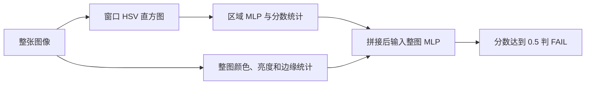
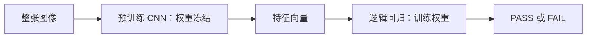
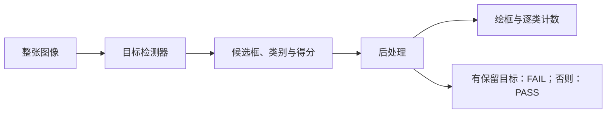

# 三种视觉方法：手工特征、CNN 特征与目标检测

图像由像素组成，模型需要从中提取与任务有关的信息。三种方法的区别主要在于：**如何提取特征，以及预测整张图像还是图像中的每个物体。**

## 1. 手工特征 + MLP

### 手工特征是什么

手工特征是人设计、程序自动计算的图像描述。例如：

- **颜色直方图：** 将颜色划分为若干区间，统计每个区间的像素比例，描述画面的颜色分布。
- **局部统计：** 汇总图块中的对比度、梯度强度和颜色变化，描述边缘与背景。

把这些统计结果按固定顺序拼接，就得到一个定长特征向量 $x$。每个位置对应固定含义，例如某个颜色区间的比例，或某个图块中的平均梯度强度。

“手工”指特征的计算规则由人设计，同一套规则自动处理所有图像。

### MLP 做什么

MLP 是多层感知器，也称 MLPNN，是由全连接层组成的前馈神经网络。全连接表示：一层的每个神经元都接收上一层的全部输出。

以一个隐藏层的二分类网络为例：

$$
h = \operatorname{ReLU}(W_1x+b_1)
$$

$$
\hat y = \sigma(w_2^Th+b_2)
$$

其中，$h$ 是隐藏层输出，$\sigma$ 是 Sigmoid 函数。约定 $y=1$ 表示 `FAIL`，$y=0$ 表示 `PASS`，则 $\hat y$ 是整图的 `FAIL` 分数。

MLP 学习的是**这些手工特征如何组合，才能区分有垃圾和无垃圾的画面**。隐藏层中的非线性激活使它能够学习比线性分类器更复杂的决策边界。

### 如何训练

区域 MLP 使用真实目标框和背景窗口监督。训练整图 MLP 时，每张训练图的窗口分数来自未见过该场景的区域模型；验证集通过最终的区域 MLP 生成输入。两级模型都使用训练数据拟合标准化参数。复现命令见[手工特征 + MLP](手工特征+MLP.md)。

### 能力与局限

这套方法给整张图像一个判断，不直接输出每件垃圾的位置和数量。

效果取决于所设计的特征是否能区分目标与背景。例如，两张图片可能有相似的颜色分布，但一张是空地面，另一张有一小片包装物；仅靠颜色统计很难区分它们。

## 2. 冻结的预训练 CNN 特征 + 线性分类器

这一方法仍然做整张图像的二分类，但把手工特征换成了**神经网络学到的特征**。

当前 `baseline2` 使用冻结 ResNet-50 的 2048 维特征，在含本地审核实拍图的 999 张训练图上拟合标准化参数和逻辑回归。默认配置、数据准备和运行命令见[冻结 CNN + 线性分类器](冻结CNN+线性分类器.md)。

### CNN 如何提取特征

CNN 是卷积神经网络。它用一个较小的卷积核在图像上滑动：在每个位置，对局部像素进行加权求和，再经过激活函数，形成新的特征图。

关键特点有两个：

- **局部连接：** 一次处理一个局部区域，保留图像的空间结构。
- **权重共享：** 同一个卷积核在不同位置使用相同参数，因此可以在不同位置识别相似的局部模式。

不同卷积核学习不同模式。经过多层处理，网络可以从局部边缘、纹理逐步形成更复杂的形状与语义特征。

CNN 与 MLP 都使用可训练的权重、激活函数和反向传播；区别在于网络如何组织图像信息。

### 预训练与冻结是什么

**预训练：** CNN 已经在其他图像数据上完成训练，得到了一组权重。

**冻结：** 在当前任务中固定这些权重，只用 CNN 计算特征。CNN 仍然参与每次预测，只是不再更新参数。

使用预训练分类网络时，取其最终分类层之前的表示。例如，ResNet50 可以通过全局平均池化，把特征图转换为一个 2048 维向量。全局平均池化就是分别计算每个通道在空间位置上的平均值。

这里提取的是特征向量，而不是沿用原网络对原有类别的分类结果。

### 线性分类器做什么

令冻结的 CNN 为 $\phi$，输入图像为 $I$，则特征为 $x=\phi(I)$。在这些特征上训练逻辑回归：

$$
\hat y=\sigma(w^Tx+b)
$$

只需学习 $w$ 和 $b$，CNN 参数保持固定。其决策边界在 CNN 特征空间中是一个超平面。

**“线性”说的是最后的分类器，不是整个图像识别过程。** 从原始像素到 CNN 特征，已经经过多层非线性变换。

### 如何训练

1. 按预训练模型的要求调整图像尺寸、颜色通道和数值范围。
2. 用冻结的 CNN 提取每张训练图像的特征。
3. 使用图像级标签训练逻辑回归，在验证集上选择设置和判定阈值。

CNN 固定后，训练图像的特征可以提前计算并缓存；摄像头新画面仍需经过 CNN 提取特征。提取时使用推理模式，使 Batch Normalization 等层的状态保持固定。

冻结特征提取属于迁移学习。若进一步解冻 CNN 的部分层，让其权重随当前任务更新，则称为微调。

### 能力与局限

预训练 CNN 提供了已经学到的图像表示，减少了自行设计特征的工作。最后只训练一个线性分类器，训练成本也较低。

这套配置仍然只输出图像级判断。小垃圾在整张图中占比很低时，缩放和全局特征汇聚可能削弱它的信号。

## 3. 适配五类垃圾的目标检测器

### 分类与检测的区别

图像分类回答“这张图有没有目标”。目标检测进一步回答“每个目标在哪里、是什么”。

一张图片可以有零个、一个或多个物体，因此检测器输出的是一组检测结果，每个结果通常包含：

- **边界框：** 物体的位置，例如左上角与右下角坐标。
- **类别：** 罐、瓶、包装物、杯、纸类物品之一。
- **得分：** 模型对该检测结果的评分。

### 检测器如何工作

以 YOLO 类检测器为例，网络主要包括：

1. **骨干网络：** 从图像提取保留空间位置的特征图。
2. **特征融合部分：** 整合不同尺度的特征，帮助检测不同大小的物体。
3. **检测头：** 根据特征预测边界框和类别相关得分。

“头”就是网络中负责具体预测任务的输出部分。分类头输出整张图的类别，检测头则预测物体的位置与类别。

检测器同样可以采用 CNN。**CNN 是一种网络结构，目标检测是一类任务，两者不是互斥的技术。**

### 如何训练

训练数据需要逐物体标注。例如，一张图中有两个瓶子和一个杯子，就需要三个框及各自类别，而不仅是一个 `FAIL` 标签。

训练时，损失函数同时衡量类别预测和边界框定位的误差，再通过反向传播更新选定的可训练参数。实际可从预训练检测器出发，将类别输出适配为本项目的五类，并进行微调。

五类指物体类别；图像级 `PASS/FAIL` 根据检测结果推导，不额外作为两个物体类别。

### 从检测结果得到计数

检测器会产生候选结果。常见后处理包括得分阈值筛选和非极大值抑制（NMS）。

NMS 用于处理同一物体附近的重复框：保留高分候选，抑制与其高度重叠的候选。重叠程度通常用交并比衡量：

$$
\operatorname{IoU}(A,B)=\frac{|A\cap B|}{|A\cup B|}
$$

其中，分子是两个框的交集面积，分母是并集面积。

完成后处理后，按类别统计保留的检测结果，就得到各类数量。**这里的计数是对检测结果做统计，不需要另外训练一个计数模型。**

例如，某张图像的最终结果如下，坐标为原始图像的像素坐标，原点位于左上角：

| 物体 | 类别 | 边界框 `(xmin, ymin, xmax, ymax)` | 得分 |
|---|---|---|---|
| 1 | 瓶 | `(40, 80, 110, 260)` | 0.91 |
| 2 | 瓶 | `(180, 60, 260, 250)` | 0.88 |
| 3 | 杯 | `(330, 120, 400, 220)` | 0.86 |

对应计数为：罐 0、瓶 2、包装物 0、杯 1、纸类 0；图像判定为 `FAIL`。

### 能力与局限

目标检测器能够完成定位、分类、计数及图像判定，是本项目完整视觉功能的基础。

它需要更细的标注，也增加了定位错误这一类问题：漏掉一个物体、把同一物体保留为多个框，或将类别分错，都会影响最终计数。

## 4. 三种方法的核心差异

| 方法 | 特征由谁决定 | 当前任务训练什么 | 所需训练标签 | 输出粒度 |
|---|---|---|---|---|
| 手工特征 + MLP | 人设计提取规则 | MLP 的权重与偏置 | 图像级标签 | 整张图像 |
| 冻结 CNN + 线性分类器 | CNN 在预训练中学习 | 线性分类器的权重与偏置 | 图像级标签 | 整张图像 |
| 目标检测器 | 检测网络学习 | 选定的可训练检测网络参数 | 每个物体的类别与框 | 每个物体，并汇总到图像 |

三种方法形成两个比较维度：**手工特征与学习特征的区别，以及图像级分类与物体级检测的区别。** 第一种使用 MLP 学习特征之间的非线性关系；第二种使用 CNN 提供表示，再做线性分类；第三种则把位置预测纳入学习目标。
