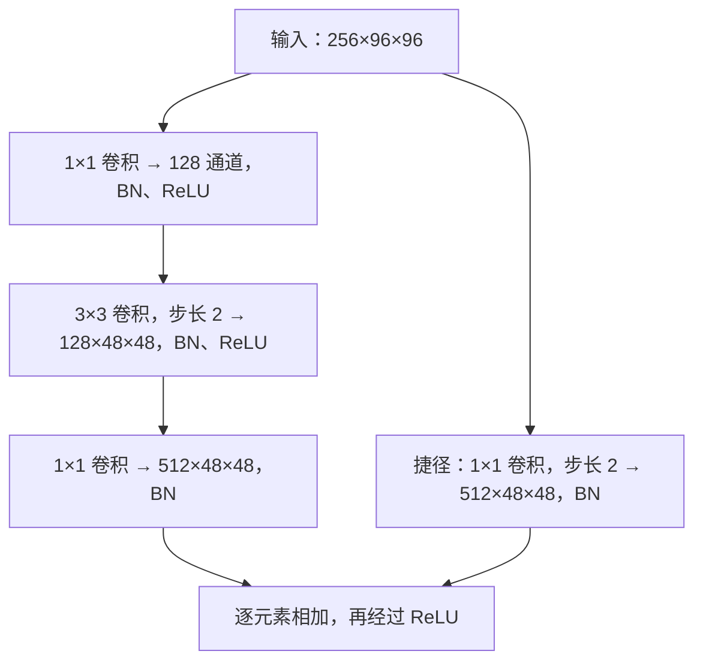

# 冻结 CNN + 线性分类器

## 运行

在项目根目录准备 Python 3.12 环境：

```bash
uv sync --locked
uv run --locked robot-cleaning-vision run --model baseline2 --input data/raw/taco/batch_5/000103.JPG
uv run --locked robot-cleaning-vision run --model baseline2 --camera 0
```

`baseline2` 默认加载 `artifacts/cnn_linear/model.pt`。该文件保存 384×384 输入配置及判定阈值，加载后即可离线推理，无需下载 ImageNet 权重。存在 CUDA 时使用 GPU，否则使用 CPU；同一进程内复用已加载模型。

图片模式保存原图、预测 JSON 和中文标注图。摄像头按 `S` / 空格保存当前帧，按 `Q` / `Esc` 或关闭窗口退出；保存结果位于 `artifacts/inference/` 的独立目录。分类结果包含 FAIL 概率、阈值和 `PASS/FAIL`，物体框与五类计数不适用。

试用重新训练的权重时，给图片或摄像头命令追加 `--model-path`，其值为训练结束时打印的 `model.pt` 路径。

## 模型结构

### 1. 冻结的 ResNet-50：从像素到特征

输入是一张等比例缩放、居中填充并归一化的 RGB 图。下表按执行顺序列出各层；尺寸按 **通道数 × 高 × 宽** 书写，省略批次维。例如 `256×96×96` 表示 256 张特征图，每张有 96 行、96 列。

| 阶段 | 运算 | 单张图的输出尺寸 |
|---|---|---|
| 输入 | RGB 三通道 | `3×384×384` |
| `conv1`、`bn1`、`relu` | 7×7 卷积，步长 2，输出 64 通道；接 BatchNorm 和 ReLU | `64×192×192` |
| `maxpool` | 3×3 最大池化，步长 2 | `64×96×96` |
| `layer1` | 3 个残差块，块内 3×3 卷积使用 64 通道 | `256×96×96` |
| `layer2` | 4 个残差块，块内 3×3 卷积使用 128 通道；首块将高宽减半 | `512×48×48` |
| `layer3` | 6 个残差块，块内 3×3 卷积使用 256 通道；首块将高宽减半 | `1024×24×24` |
| `layer4` | 3 个残差块，块内 3×3 卷积使用 512 通道；首块将高宽减半 | `2048×12×12` |
| `avgpool` | 全局平均池化：每个通道的 12×12 个值取平均 | `2048×1×1` |
| 展平、`fc` | 展平为向量；原 ImageNet 分类层替换为 `Identity`，原样传出特征 | `2048` |

**一个残差块怎样工作？** 输入同时沿两条路径前进。主分支先用 1×1 卷积组合通道，再用 3×3 卷积提取邻域特征，最后用 1×1 卷积扩展输出通道。捷径分支保留输入；当形状改变时，用 1×1 卷积和 BatchNorm 将它变为与主分支相同的形状。两条分支逐元素相加，再经过 ReLU。以 `layer2` 的第一个块为例：



骨干采用 torchvision 的 `ResNet50_Weights.IMAGENET1K_V2`。移除原分类层后，保留的 **23,508,032 个骨干参数全部冻结**。实现见 [`FeatureExtractor`](../src/robot_cleaning_vision/models/cnn_linear/model.py)。

冻结包含三项操作：

- `requires_grad_(False)`：骨干参数不参与梯度更新。
- `eval()`：BatchNorm 使用已有运行统计量，提取训练图特征时也保持固定。
- `torch.inference_mode()`：提取过程不构建反向传播计算图。

### 2. 线性分类头：从 2048 个特征到一个 FAIL 概率

全局平均池化后，每个通道只留下一个数，描述该通道在整张图上的平均响应。接下来的分类头没有隐藏层：先逐维标准化，再做一次 `2048 → 1` 的加权求和，最后用 sigmoid 得到整图概率。物体位置不会从这 2048 个数解码出来。

令第 $j$ 个通道的特征为 $x_j$，训练集上该维的均值和缩放量为 $\mu_j,s_j$：

$$
z_j=\frac{x_j-\mu_j}{s_j},\qquad
p=\sigma(w^Tz+b)=\frac{1}{1+\exp(-(w^Tz+b))}.
$$

其中 $w$ 有 2048 个系数，$b$ 是一个截距，合计 **2,049 个分类器参数**。训练还会单独估计 2048 个均值和 2048 个缩放量；零方差特征的缩放量取 1。逻辑回归采用 L2 正则化，`C=0.001`，用 `lbfgs` 求解，最多迭代 2000 次，随机种子为 42。训练实现见 [`train.py`](../src/robot_cleaning_vision/models/cnn_linear/train.py)。

标签编码为 `PASS=0`、`FAIL=1`，因此输出 $p$ 表示“整张图至少含一个项目目标”的概率估计。程序将它与权重里保存的阈值比较，得到一次 PASS/FAIL 判定；不输出五类各自的概率、框或数量。

## 预处理

训练和推理共用 `robot_cleaning_vision.preprocessing.preprocess`，保留完整画面：

1. 图片按 EXIF 方向转正后作为 PIL RGB 图像读取；摄像头输入为 OpenCV BGR `uint8` 帧。
2. 双线性等比例缩放并居中填充到 384×384，奇数填充余量放在右侧或下侧。
3. 输出通道顺序为 RGB，填充值为 `(124, 116, 104)`。
4. 转为 `float32`，逐通道按 `(像素 / 255 - mean) / std` 归一化。
5. RGB 均值为 `(0.485, 0.456, 0.406)`，标准差为 `(0.229, 0.224, 0.225)`；再转换为 CNN 所需的 NCHW 张量。

填充与缩放配置随权重保存。结果显示使用原图，分类输出为整图判定。

## 训练数据与阈值

先按 [TACO 数据处理](../dataprocessing/taco/README.md)准备 TACO 标注，再按[补充数据指南](../dataprocessing/README.md)恢复图片并转换补充标注。

| 用途 | 数据 |
|---|---|
| 拟合标准化参数和逻辑回归 | TACO train 621 张、CoxPWD 110 张、Wikimedia 21 张、Indoor Waste train 52 张，共 804 张（PASS 230、FAIL 574） |
| 选择判定阈值 | 原 TACO 固定 val |
| 训练结束时评估 | 原 TACO 固定 test；室内留出和本地实测图片不参与此命令 |

训练组合固定为 `all-plus-indoor`。TACO 使用 `data/raw/taco/annotations_project.json`；CoxPWD/Wikimedia 使用 `data/processed/supplemental/annotations_project.json`；Indoor Waste 使用同目录下的 `indoor_annotations_project.json`。

项目五类为罐、瓶、包装物、杯、纸类物品。整图有至少一个项目目标时标签为 FAIL，无项目目标时为 PASS。补充图片的来源、场景分组、标签和许可见审核清单。Indoor Waste 的留出图片由 `indoor_holdout.json` 及其 SHA-256 固定，与训练图片分开。

阈值仅用 TACO val 的真实标签与 FAIL 概率确定：

1. 枚举 ROC 曲线的完整阈值，保留 FAIL 召回率至少 90% 的候选。
2. 优先选择 PASS 召回率最高的候选；并列时选择 FAIL 召回率更高的候选。
3. 在保持该判定的相邻得分间隔内取中点，并保证结果严格大于下界；全部保留时取 0。

当前保留权重的阈值为 `0.654033474507234`。`P(FAIL)` 大于等于阈值时判 FAIL，否则判 PASS。重新训练会计算新阈值并写入新权重，推理时自动读取。

## 当前权重的分类成绩

评估使用 `artifacts/cnn_linear/model.pt`，以 FAIL（图中至少有一个项目目标）为正类。阈值由 TACO 验证集选定；TACO 测试集和 Indoor Waste 室内留出集均沿用该阈值。

| 指标 | TACO 验证集 | TACO 测试集 | Indoor Waste 室内留出集 |
|---|---:|---:|---:|
| 图片数（FAIL / PASS） | 134（107 / 27） | 134（108 / 26） | 52（32 / 20） |
| 有目标，正确判 FAIL（TP） | 98 | 94 | 27 |
| 有目标，漏判为 PASS（FN） | 9 | 14 | 5 |
| 无目标，正确判 PASS（TN） | 17 | 19 | 18 |
| 无目标，误判为 FAIL（FP） | 10 | 7 | 2 |
| FAIL 精确率 | 90.74% | 93.07% | 93.10% |
| FAIL 召回率 | 91.59% | 87.04% | 84.38% |
| FAIL F1 | 0.912 | 0.900 | 0.885 |
| PASS 召回率 | 62.96% | 73.08% | 90.00% |
| 平衡准确率 | 77.28% | 80.06% | 87.19% |
| ROC-AUC | 0.895 | 0.860 | 0.948 |

验证集达到了选阈值时设定的 90% FAIL 召回率，两组独立测试数据均低于该水平。室内留出集来自 Indoor Waste，机器人摄像头实拍效果仍需单独评估。

## 训练与权重

准备好全部训练图片和标注后运行：

```bash
uv run --locked python -m robot_cleaning_vision.models.cnn_linear.train
```

训练配置固定为 `all-plus-indoor`、384×384 和 `C=0.001`。首次训练需要下载 torchvision 官方 ResNet-50 V2 权重，已有 PyTorch 缓存时可复用。训练分批提取冻结特征，以训练集拟合标准化参数和逻辑回归，再用 TACO val 选阈值。

每次运行在 `artifacts/cnn_linear/training/<时间戳_随机后缀>/` 新建目录，仅写入 `model.pt`。训练在终端打印验证集和测试集指标及新权重路径；默认权重保持不变。

| 权重内容 | 用途 |
|---|---|
| ResNet-50 骨干参数与 BatchNorm 运行统计量 | 离线重建冻结特征提取器 |
| 2048 维标准化均值与缩放量 | 复现训练集特征标准化 |
| 2048 维逻辑回归系数与截距 | 计算 FAIL 概率 |
| 预处理配置、标签映射与阈值 | 复现输入处理和最终判定 |
| 格式标识与预训练权重名称 | 加载时检查模型兼容性 |

新权重可直接通过 `--model-path` 使用。
