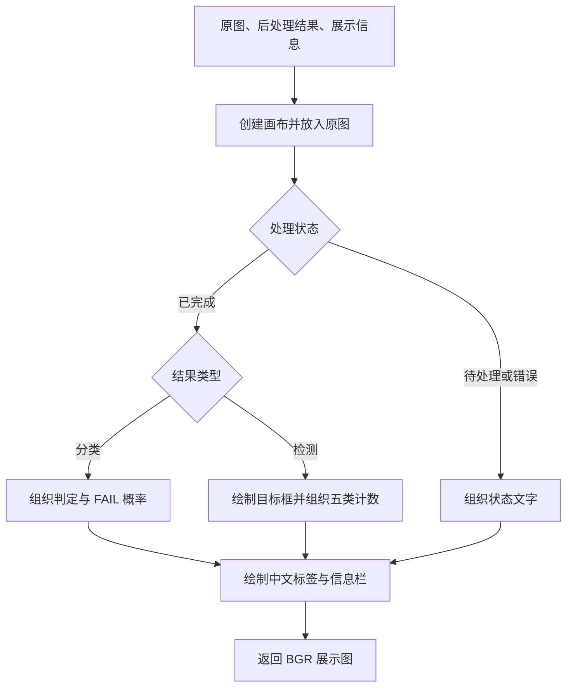

# 可视化模块

## 作用

`visualization` 将原图和后处理结果组合成一张展示图：左侧保留原图，右侧增加中文信息栏。检测框与标签绘制在原图区域。

本文记录已确定的模块设计，供后续实现使用。

## 输入与输出

| 项目 | 内容 |
|---|---|
| 原图 | BGR、`uint8` 的 NumPy 数组，形状为 `(高度, 宽度, 3)` |
| 后处理结果 | 图像判定、图像级得分，以及对应方法的目标列表和类别计数 |
| 展示信息 | 模型名称、处理状态、最近完成帧的耗时（毫秒） |
| 绘制配置 | 中文字体、字号、侧栏宽度、类别名称与颜色 |
| 输出 | 包含原图标注和右侧信息栏的 BGR `uint8` 图像 |

绘制使用独立画布，原图可继续用于保存或其他处理。画布宽度为原图宽度加侧栏宽度，高度取原图高度与信息栏所需高度的较大值，原图放置在左上角。

## 处理流程

### 1. 整理展示内容

分类方法显示模型名称、处理状态、PASS/FAIL、FAIL 概率及最近完成帧耗时。

检测方法显示模型名称、处理状态、PASS/FAIL、五类计数及最近完成帧耗时。每个目标携带原图坐标下的 `xyxy` 框、类别与得分。

| 场景 | 展示效果 |
|---|---|
| 分类完成 | 图像判定与 FAIL 概率；框和计数项省略 |
| 检测完成且有目标 | 原图上的框、中文类别及目标得分；侧栏中的判定与五类计数 |
| 检测完成且目标为空 | PASS，五类计数均为 0 |
| 待处理 | 模型名称与“待处理”状态，判定区域显示“—” |
| 处理错误 | 模型名称、“处理错误”及错误信息，判定区域显示“—” |

分类的 FAIL 概率表示模型对图像需要清理的概率估计。检测的得分属于各个目标，展示在对应框旁。

### 2. 绘制目标框

直接使用后处理提供的原图坐标。绘制时将浮点坐标转换为像素位置，框旁添加“类别名称 + 得分”，例如“塑料瓶 92%”。类别名称以项目类别映射为准。

五类目标各使用固定颜色，边框与标签颜色保持一致。标签优先放在框的上方，靠近图像边缘时调整到图像区域内。

### 3. 绘制中文信息栏

信息栏按以下顺序排列：

1. 模型名称。
2. 处理状态。
3. 图像判定：PASS 使用绿色，FAIL 使用红色。
4. 分类的 FAIL 概率，或检测的五类计数。
5. 最近完成帧耗时，单位为毫秒。

中文使用 Pillow 和指定的中文字体绘制。字体在绘制器初始化时加载，各帧复用。

颜色通道按绘制阶段转换：输入为 BGR，Pillow 绘字阶段使用 RGB，最终转换为 BGR 返回。目标类别配色在两种通道顺序之间同步转换。

### 4. 返回展示图

调用方接收绘制结果，再交给 OpenCV 窗口显示或图片保存流程。

## 与其他模块的配合

| 模块 | 职责 |
|---|---|
| `postprocessing` | 提供筛选后的目标、原图坐标、类别计数与图像判定 |
| `visualization` | 将结果绘制为中文展示图 |
| 主调度流程 | 传入模型与状态信息，管理显示、计时和交互 |

响应时间覆盖预处理、推理、后处理和显示更新调用，由主调度流程记录。当前帧显示更新完成后获得耗时，下一次绘制时展示该数值；首次绘制时显示“—”。
