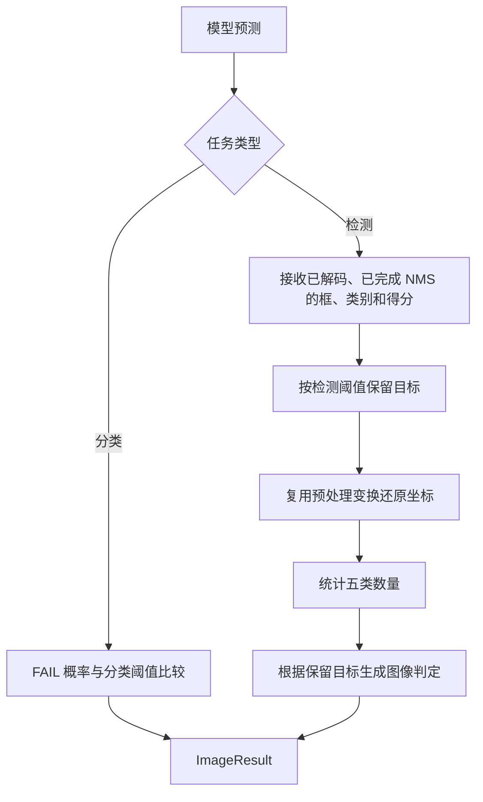

# 预测后处理

对应源码：[`postprocessing/__init__.py`](../src/robot_cleaning_vision/postprocessing/__init__.py)。

后处理将模型预测转换为统一的 `ImageResult`，供后续显示与业务逻辑使用。模块通过 Python API 返回内存中的结果。

## 1. 整体流程



分类阈值和检测阈值由调用方分别传入。两者都使用“大于等于阈值”的规则。

## 2. 统一结果

`ImageResult` 是一个 dataclass，通过字段访问结果：

| 字段 | 分类 | 检测 |
|---|---|---|
| `decision` | 根据 FAIL 概率得到 `PASS` 或 `FAIL` | 存在保留目标为 `FAIL`，空结果为 `PASS` |
| `image_score` | 输入的 FAIL 概率 | `None` |
| `objects` | `None` | `Detection` 列表，空结果为 `[]` |
| `counts` | `None` | 五类数量，包含零计数类别 |

每个 `Detection` 包含三个字段：

- `bbox`：原图上的浮点 xyxy 元组 `(xmin, ymin, xmax, ymax)`，单位为像素。
- `class_id`：项目类别 ID。
- `score`：该目标的模型得分。

`None` 表示该字段对当前任务无对应含义；`[]` 和零计数表示检测结果为空。

## 3. 分类逻辑

接口：

```python
postprocess_classification(fail_probability, *, threshold)
```

`fail_probability` 是图像为 FAIL 的概率，取值范围为 `[0, 1]`。`threshold` 是同一范围内的分类阈值。

判定规则：

```python
decision = "FAIL" if fail_probability >= threshold else "PASS"
```

函数将输入概率作为 `image_score`，将 `objects`、`counts` 设为 `None`。

```python
from robot_cleaning_vision.postprocessing import postprocess_classification

result = postprocess_classification(0.7, threshold=0.7)
print(result.decision)     # FAIL
print(result.image_score)  # 0.7
```

## 4. 检测逻辑

接口：

```python
postprocess_detection(boxes, class_ids, scores, transform, *, threshold)
```

### 4.1 输入约定

| 参数 | 含义 |
|---|---|
| `boxes` | `(N, 4)` 数组，预处理图像上的 xyxy 像素坐标，宽高为正 |
| `class_ids` | `(N,)` 整数数组，使用项目类别 ID |
| `scores` | `(N,)` 得分数组，范围为 `[0, 1]` |
| `transform` | 当前图像经 `preprocess` 返回的 `LetterboxTransform` |
| `threshold` | 五类共用的检测得分阈值，范围为 `[0, 1]` |

坐标、得分和阈值均取有限数值。三个数组的第 i 项共同描述一个目标，模型侧已完成解码与 NMS。

项目类别与数据整理模块一致：

| ID | 类别 |
|---|---|
| 1 | 罐 |
| 2 | 瓶 |
| 3 | 包装物 |
| 4 | 杯 |
| 5 | 纸类物品 |

`CATEGORY_NAMES[class_id - 1]` 可获取类别名称。模型采用其他类别编码时，调用方先映射为项目 ID。

### 4.2 得分筛选

核心代码：

```python
keep = scores >= threshold
```

`keep` 是布尔数组，同时用于筛选框、类别和得分，使三者保持对应关系。保留目标沿用输入顺序及模型给出的逐目标得分。

### 4.3 坐标还原

预处理通过等比例缩放与居中填充生成模型输入。还原时直接调用：

```python
restored = transform.inverse_boxes(boxes[keep])
```

设实际横纵缩放比例为 `scale_x`、`scale_y`，左、上填充为 `left`、`top`，其逆变换为：

```text
原图 x = (模型输入 x - left) / scale_x
原图 y = (模型输入 y - top) / scale_y
```

框的两个角分别使用这组变换。实际缩放尺寸经过整数取整，横纵比例可能略有差异；复用 `transform` 能与预处理使用相同的比例和偏移。

返回坐标保留浮点精度以及原始越界范围，输入数组保持原值。

### 4.4 计数与图像判定

函数先为五类建立零计数，再逐个累加保留目标：

```python
counts = dict.fromkeys(range(1, 6), 0)
for obj in objects:
    counts[obj.class_id] += 1
```

图像判定由保留目标列表决定：

```python
decision = "FAIL" if objects else "PASS"
```

空输入使用 `np.empty((0, 4))`、空类别数组和空得分数组，得到 `PASS`、空目标列表与五类零计数。

## 5. 检测调用示例

```python
import numpy as np

from robot_cleaning_vision.preprocessing import preprocess
from robot_cleaning_vision.postprocessing import postprocess_detection

frame = np.zeros((360, 640, 3), dtype=np.uint8)
image, transform = preprocess(frame, target_size=(640, 640))

# 示例模型输出：坐标位于 640×640 的预处理图像上，已完成解码与 NMS。
result = postprocess_detection(
    boxes=np.array([[100, 190, 300, 340], [20, 150, 80, 200]]),
    class_ids=np.array([2, 4]),
    scores=np.array([0.9, 0.3]),
    transform=transform,
    threshold=0.5,
)

print(result.decision)         # FAIL
print(result.image_score)      # None
print(result.objects[0].bbox)  # (100.0, 50.0, 300.0, 200.0)
print(result.objects[0].score) # 0.9
print(result.counts)           # {1: 0, 2: 1, 3: 0, 4: 0, 5: 0}
```

原图高度为 360，目标高度为 640，上下各填充 140 像素。瓶的得分达到阈值，坐标还原时减去上方填充；杯的得分低于阈值，最终仅保留瓶。
