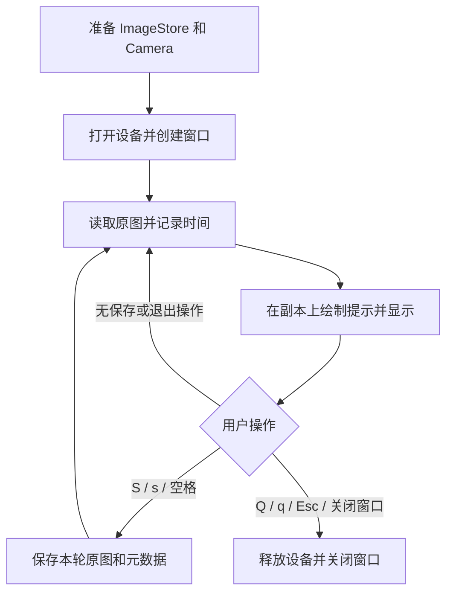

# 图像采集

本文对应项目的 `capture` 图像采集模块，以及调用它的 `main.py`。重点是理解“摄像头 → 图像帧 → 预览 → 保存”的完整过程，不涉及模型识别、类别标注或视频录制。

## 1. 模块做什么

- 从本地摄像头、网络视频流或视频文件中读取图像。
- 在窗口中实时预览，通过按键保存当前帧。
- 保存不带提示文字的原始彩色 PNG，并记录 CSV 元数据。
- 正常退出或出现异常时释放摄像头资源。

项目文件分工：

| 文件 | 职责 | 主要接口 |
|---|---|---|
| `src/robot_cleaning_vision/main.py` | 解析命令行、启动采集、报告运行错误 | `main()` |
| `src/robot_cleaning_vision/capture/camera.py` | 管理采集设备，不负责窗口和按键 | `Camera`、`CameraError` |
| `src/robot_cleaning_vision/capture/preview.py` | 显示画面、处理按键、调度保存 | `draw_preview()`、`run_capture()` |
| `src/robot_cleaning_vision/capture/storage.py` | 保存 PNG 和 CSV，不负责显示 | `ImageStore`、`ImageRecord`、`SaveError` |

## 2. 先理解图像帧

视频可以理解为连续获取的一系列图像，每张图像叫一帧，代码中通常命名为 `frame`。

本项目的原始帧是 NumPy 数组：

```python
height, width, channels = frame.shape
```

| 属性 | 含义 |
|---|---|
| `frame.shape` | `(高, 宽, 3)`，注意高度在前、宽度在后 |
| `frame.dtype` | `uint8`，每个通道的数值范围为 0～255 |
| `frame[y, x]` | 第 y 行、第 x 列的像素，三个分量依次为 B、G、R |

OpenCV 常用的彩色通道顺序是 **BGR**，不是 RGB。

```python
gray = cv2.cvtColor(frame, cv2.COLOR_BGR2GRAY)
```

这会生成灰度图，通常形状为 `(高, 宽)`。前面的入门示例显示灰度图，但项目当前保存的是三通道 BGR 彩色原图；不能直接把灰度图传给本项目的 `ImageStore.save()`。

`BGRFrame = NDArray[np.uint8]` 是类型提示，本身不会检查数组形状。项目在读帧、保存时另有运行时检查。

## 3. OpenCV 采集的基本接口

| 接口 | 作用 | 需要注意 |
|---|---|---|
| `cv2.VideoCapture(0)` | 创建对象并尝试打开编号为 0 的设备 | 创建对象不代表设备一定打开成功 |
| `cv2.VideoCapture()` | 只创建采集对象 | 后续调用 `open(source)` |
| `cap.open(source)` | 尝试打开来源，返回是否成功 | 是执行操作，不是只检查状态 |
| `cap.isOpened()` | 检查当前是否已打开 | 已打开也不保证下一帧读取成功 |
| `cap.read()` | 返回 `(ret, frame)` | `ret` 表示读取是否成功，`frame` 是图像 |
| `cap.release()` | 释放设备或视频流 | 与关闭显示窗口不是同一件事 |
| `cv2.imshow(name, frame)` | 在窗口显示图像 | 不负责从摄像头读取图像 |
| `cv2.waitKey(delay)` | 处理窗口事件并等待按键 | 单位毫秒；`0` 为持续等待，`1` 不是严格的帧率控制 |
| `cv2.destroyAllWindows()` | 关闭 OpenCV 窗口 | 不代替 `cap.release()` |

### 3.1 初始化失败时用 open 还是 isOpened

两种常见写法：

```python
# 创建时尝试打开，再检查结果
cap = cv2.VideoCapture(0)
if not cap.isOpened():
    print("无法打开摄像头")
```

```python
# 创建与打开分开，直接检查 open() 的返回值
cap = cv2.VideoCapture()
if not cap.open(0):
    print("无法打开摄像头")
```

本项目的 `Camera.open()` 使用第二种方式。打开失败就报告错误，不会自动重试；再次调用 `open()` 也不能保证解决设备占用、权限或地址错误。

### 3.2 最小、安全的预览示例

下面是独立入门示例

```python
import cv2 as cv


def main():
    cap = cv.VideoCapture(0)
    try:
        if not cap.isOpened():
            print("无法打开摄像头")
            return

        while True:
            ret, frame = cap.read()
            if not ret or frame is None:
                print("读取画面失败")
                break

            gray = cv.cvtColor(frame, cv.COLOR_BGR2GRAY)
            cv.imshow("frame", gray)
            if cv.waitKey(1) & 0xFF == ord("q"):
                break
    finally:
        cap.release()
        cv.destroyAllWindows()


if __name__ == "__main__":
    main()
```

- 先检查读帧结果，再进行颜色转换，避免向 `cvtColor()` 传入空图像。
- `ord("q")` 得到字符 q 的整数编码；`& 0xFF` 保留按键返回值的低八位。
- `finally` 在正常退出、`return` 或异常展开时执行清理；不能保证进程被强杀或断电时执行。
- 这个最小示例用 q 退出；项目预览另外处理了关闭窗口、Q 和 Esc。

## 4. camera.py：与界面无关的采集接口

“不依赖窗口或按键”的意思是：**不用 `imshow()`、不用 `waitKey()`，也能获取图像供算法处理。** 它不是不支持预览，而是把采集和界面分开。

`Camera` 的主要行为：

| 方法 | 行为 |
|---|---|
| `Camera(source, width=..., height=...)` | 记录配置，构造时不打开设备 |
| `open()` | 打开设备并请求分辨率；已持有设备时直接返回当前对象 |
| `read()` | 返回一张原始 BGR 图像，不返回 OpenCV 的二元组 |
| `release()` | 清空内部设备引用并释放设备，支持重复调用 |
| `__enter__()` / `__exit__()` | 支持 `with`，进入时打开、退出时释放 |

与底层 OpenCV 的区别：

```python
# 原生 OpenCV：调用者检查布尔值
ret, frame = cap.read()

# 项目封装：成功返回图像，失败抛出 CameraError
frame = camera.read()
```

`Camera.read()` 会检查读取结果、空图像、三通道形状以及 `uint8` 类型；读帧失败时释放设备并抛出异常。未调用 `open()` 就读取也会报错。视频文件到达末尾在当前实现中属于读帧失败，不会自动循环播放。

### 不打开窗口，读取一帧

在项目环境中可以这样使用：

```python
from robot_cleaning_vision.capture.camera import Camera, CameraError

try:
    with Camera(0) as camera:
        frame = camera.read()
        print(frame.shape, frame.dtype)
except CameraError as error:
    print(f"采集失败：{error}")
```

`with Camera(0) as camera` 自动调用 `__enter__()`，离开代码块时调用 `__exit__()`。它管理的是设备，不需要调用窗口清理函数。

## 5. preview.py：预览和按键调度

### draw_preview()

先执行 `frame.copy()`，再在副本上绘制：

- 当前场景名。
- 本次运行成功保存的数量。
- 保存、退出的按键提示。
- 最近一次保存状态。

OpenCV 的绘图函数会修改传入数组，因此不能直接在准备保存的原图上叠字。窗口标题显示完整场景名，画面内非 ASCII 字符使用转义显示，因为这里使用的 OpenCV 内置字体不支持直接绘制中文。

### run_capture()



要点：

- 保存发生在下一次 `read()` 之前，使用本轮显示对应的原始帧，不是下一帧。
- 按一次保存键处理一次保存，不是录制视频。
- 保存成功才增加计数，`run_capture()` 返回本次成功保存数量，不包含历史数量。
- `SaveError` 会显示错误并允许继续；打开或读帧失败则结束，由命令行入口报告。
- 清理使用嵌套 `finally`，即使设备释放抛出异常，也会尝试关闭窗口。

## 6. storage.py：保存原图和元数据

使用示例：

```python
from robot_cleaning_vision.capture.camera import Camera
from robot_cleaning_vision.capture.storage import ImageStore

store = ImageStore("data/raw/local", "scene_001", 0)
with Camera(0) as camera:
    frame = camera.read()
    record = store.save(frame)
    print(store.output_dir / record.file_name)
```

此例不创建窗口，但会实际打开摄像头并保存一张图片。省略 `captured_at` 时，保存接口使用调用时的本地带时区时间；预览程序则显式传入该帧读取完成后的时间。

默认输出结构：

```text
data/raw/local/
├── images.csv
└── scene_001/
    └── <采集时间>_<UUID>.png
```

### 为什么保存 PNG

PNG 无损编码，保留传入原图的像素与实际尺寸；没有预览文字，也不先转成灰度。它不会提高摄像头本身的画质。

项目使用 `cv2.imencode(".png", frame)` 编码，再通过 Python 文件接口写入，便于支持中文路径。文件以 `xb` 模式独占创建，已有文件不会被覆盖。

### CSV 字段

| 字段 | 含义 |
|---|---|
| `image_id` | 包含 `.png` 扩展名的图片文件名，由时间和 UUID 组成 |
| `scene_id` | 物理场景名 |
| `file_name` | 相对输出根目录的路径，例如 `scene_001/xxx.png` |
| `captured_at` | 含时区偏移的 ISO 8601 时间 |
| `width` / `height` | 保存图像的实际宽、高，单位像素 |
| `camera_source` | 摄像头编号、视频流地址或视频文件路径的字符串表示 |

`scene_id` 表示物理布置，不是垃圾类别。同一布置重复拍摄共用一个场景名，改变物体布置后更换。它必须是非空的单级目录名，不能包含路径分隔符等非法字符。

### 保存顺序与失败处理

1. 校验图像和时间格式，生成元数据。
2. 编码并创建 PNG。
3. 检查 CSV 表头，追加一条记录；空文件先写表头。
4. 追加失败时尝试把 CSV 截回原位置，并删除本次图片。

重复运行会追加数据，不会清空历史记录。现有 CSV 表头不匹配会报错，不会强行覆盖。回退是针对可处理异常的清理措施，不是数据库事务：不保证断电、进程强杀时的一致性，也不支持多个进程同时写同一 CSV。清理图片失败时会明确报告。

采集模块不生成类别、边界框或 `PASS/FAIL` 标签，这些属于后续流程。

## 7. main.py：命令行参数从哪里来

`main()` 本身没有读取参数的特殊能力，真正执行解析的是标准库 `argparse`。

### 第一步：注册命令入口

`pyproject.toml` 中：

```toml
[project.scripts]
robot-cleaning-vision = "robot_cleaning_vision.main:main"
```

安装项目后，执行 `robot-cleaning-vision` 会调用 `robot_cleaning_vision.main` 模块中的 `main()`。

### 第二步：定义参数规则

核心代码的简化形式：

```python
parser = argparse.ArgumentParser()
subparsers = parser.add_subparsers(dest="command")
capture = subparsers.add_parser("capture")
capture.add_argument("--camera", type=_camera_source, default=0)
capture.add_argument("--scene-id", required=True)
args = parser.parse_args()
```

`parse_args()` 不传入参数列表时，默认解析 `sys.argv[1:]`，即当前 Python 进程命令行中去掉程序名后的参数。

在项目根目录执行：

```bash
uv run robot-cleaning-vision capture --camera 1 --scene-id room01
```

其中 `uv run` 用于启动项目环境中的命令；应用解析的是 `capture --camera 1 --scene-id room01`，不是 `uv run`。

得到的属性相当于：

```python
args.command == "capture"
args.camera == 1
args.scene_id == "room01"
args.output == "data/raw/local"
args.width is None
args.height is None
```

参数名中的 `-` 自动变成属性名中的 `_`，所以 `--scene-id` 对应 `args.scene_id`。

### 第三步：转换和校验

| 参数 | 转换或规则 | 默认值 |
|---|---|---|
| `--camera` | `_camera_source()`：可转为整数则转为设备编号，否则保留字符串 | `0` |
| `--output` | 输出根目录，相对路径基于进程工作目录 | `data/raw/local` |
| `--scene-id` | argparse 检查必填，`ImageStore` 再检查目录名是否合法 | 无，必须提供 |
| `--width` | `_positive_pixels()` 检查正整数 | `None` |
| `--height` | `_positive_pixels()` 检查正整数 | `None` |

分辨率只是请求，设备可能忽略设置，最终尺寸以 `frame.shape` 为准。纯数字的 `--camera` 值会被解释为设备编号。

### 第四步：调用业务函数

```python
run_capture(
    args.camera,
    args.output,
    args.scene_id,
    width=args.width,
    height=args.height,
)
```

不提供子命令时显示帮助；`--help` 由 argparse 处理。运行中的已捕获错误以退出码 `1` 报告，`Ctrl+C` 对应退出码 `130`；参数用法错误通常由 argparse 以退出码 `2` 结束。

`if __name__ == "__main__": main()` 则用于通过模块执行方式启动；模块被普通 `import` 时不会因为这段判断自动运行 `main()`。

## 8. 常用运行方式

在项目根目录运行：

```bash
# 查看采集参数，不打开摄像头
uv run robot-cleaning-vision capture --help

# 本地摄像头
uv run robot-cleaning-vision capture --camera 0 --scene-id scene_001

# 请求 1280 × 720，实际尺寸以设备输出为准
uv run robot-cleaning-vision capture --camera 0 --scene-id scene_001 --width 1280 --height 720

# 视频文件
uv run robot-cleaning-vision capture --camera "data/example.mp4" --scene-id video_001

# 手机应用提供的网络视频流：地址仅为示例，需替换
uv run robot-cleaning-vision capture --camera "http://192.168.1.100:8080/video" --scene-id phone_001
```

手机连接有两类：

- 安装虚拟摄像头应用及所需电脑驱动，让手机作为本地设备出现，再选择对应编号。
- 手机应用提供 HTTP、RTSP 等视频流，用实际视频流地址连接；一般先让电脑和手机处于可互通的局域网。

视频流地址不一定等于网页管理地址。协议与解码器支持取决于本地 OpenCV，且当前代码不自动重连。不建议将手机摄像头服务直接暴露到公网。`camera_source` 会原样写入 CSV，不要随意共享含账号密码的流地址及其元数据。

## 9. 常见误区速查

| 误区 | 正确认识 |
|---|---|
| `cap.read()` 只返回一个布尔值 | 原生接口返回 `(ret, frame)`；项目 `Camera.read()` 返回帧或抛异常 |
| 摄像头打开成功就一定能读帧 | 两者需要分别检查 |
| 初始化失败后调用 `isOpened()` 就能重新打开 | 它只检查状态；`open()` 才执行打开操作 |
| `imshow()` 会采集摄像头画面 | 它只显示已经获取到的图像 |
| 不需要按键就可以删掉预览中的 `waitKey()` | 它还承担窗口事件处理，不能只把它当作按键检测 |
| `waitKey(1)` 表示每秒 1000 帧 | 实际速度还受采集、解码、绘制和保存耗时影响 |
| 关闭窗口就释放了摄像头 | 窗口和设备是不同资源，需要分别清理 |
| 显示副本上的提示文字也会保存 | 项目保存原始 `frame`，不保存绘制后的副本 |
| 设置宽高后一定得到该分辨率 | 设备可能忽略请求，应检查实际帧 |
| 按保存键会录制视频 | 当前模块只保存单张 PNG 和元数据 |

## 10. 建议阅读顺序

1. `camera.py`：理解设备生命周期，以及返回值与异常。
2. `storage.py`：理解图片、元数据和失败清理。
3. `preview.py`：理解主循环如何把采集、显示、保存串起来。
4. `main.py`：理解命令行参数如何进入业务函数。

相关文档：[项目使用说明](../README.md)、[OpenCV 学习笔记](opencv.md)、[架构设计](架构设计.md)。
