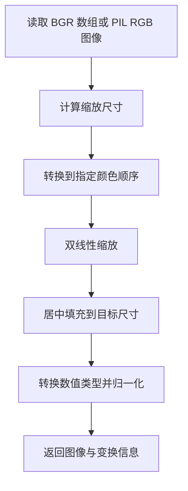

# 图像预处理

实现位于 `src/robot_cleaning_vision/preprocessing/__init__.py`，提供 `preprocess()` 和 `LetterboxTransform`。

## 1. 输入与输出

预处理将摄像头和数据集图像整理为调用方需要的尺寸、颜色与数值格式，同时记录几何变换，供检测框映射和还原使用。

| 项目 | 约定 |
|---|---|
| 摄像头输入 | BGR `uint8` NumPy 数组，形状为 `(高, 宽, 3)` |
| 数据集输入 | PIL RGB 图像 |
| 目标尺寸 | `target_size=(高, 宽)`，由调用方指定 |
| 图像输出 | 独立的 HWC NumPy 数组，原始输入保持原样 |
| 变换输出 | `LetterboxTransform`，记录尺寸、实际比例与填充量 |

### HWC：图像数组的排列方式

HWC 按高度（Height）、宽度（Width）、通道（Channel）排列数组维度。例如，
`image.shape == (480, 640, 3)` 表示高 480、宽 640、三个颜色通道。
`image[y, x]` 取出第 y 行、第 x 列像素的三个通道值。

HWC 描述维度顺序，RGB/BGR 描述每个像素内部的通道顺序：
RGB 为红、绿、蓝，BGR 为蓝、绿、红。`uint8` 表示每个通道用 0～255 的整数存储；
`float32` 表示用浮点数存储，适合后续归一化计算。


## 2. 处理顺序



### Letterbox：等比例缩放与填充

Letterbox 先用同一个理论比例缩放宽高，再通过填充补齐目标画布，保留完整画面与物体比例。
例如，将宽 640、高 480 的图像放入 640 × 640 的画布时，图像保持原尺寸，
上下各填充 80 像素。较大的图像先缩小，较小的图像先放大，再填充剩余空间。

HWC 描述图像怎么存，letterbox 描述图像尺寸怎么变。

设原图尺寸为 `(H, W)`，目标尺寸为 `(Ht, Wt)`：

```text
r = min(Ht / H, Wt / W)
Hr = max(1, round(H * r))
Wr = max(1, round(W * r))
```

`cv2.resize()` 使用双线性插值，将图像缩放到 `(Hr, Wr)`。其中 NumPy 尺寸习惯为高、宽，OpenCV 的尺寸参数为宽、高。

剩余空间分配到四周：

```text
left   = (Wt - Wr) // 2
right  = Wt - Wr - left
top    = (Ht - Hr) // 2
bottom = Ht - Hr - top
```

奇数余量放在右侧或下侧。`fill` 可以是单个灰度值，也可以是按输出颜色顺序排列的三个通道值，使用 0–255 像素值。

### 颜色与数值变换

`color` 指定输出为 RGB 或 BGR，默认 RGB。输入颜色顺序由输入类型确定，通道转换交换首尾两个通道。

填充后的图像先转换为 `dtype`，再按下式逐通道计算：

```text
output = (pixel * scale - mean) / std
```

默认 `dtype=np.uint8`、`scale=1`，省略的 `mean` 和 `std` 分别按 0 和 1 处理。归一化使用浮点 `dtype`，`mean` 与 `std` 按输出通道顺序配置，标准差取非零值。填充区域参与相同的数值变换。

## 3. 变换信息与坐标

| 字段 | 含义 |
|---|---|
| `original_size` | 原图 `(H, W)` |
| `resized_size` | 实际缩放尺寸 `(Hr, Wr)` |
| `target_size` | 输出尺寸 `(Ht, Wt)` |
| `scale` | 实际比例 `(Wr / W, Hr / H)`，分别对应 x、y |
| `padding` | `(left, top, right, bottom)` |

像素尺寸经过整数取整，宽高的实际比例可能略有差异。因此，坐标变换分别使用 `sx=Wr/W` 和 `sy=Hr/H`。

正向映射先缩放，再加上填充偏移；还原时先减偏移，再除以实际比例：

```text
正向：x' = x * sx + left    y' = y * sy + top
还原：x  = (x' - left) / sx  y  = (y' - top) / sy
```

`forward_boxes()` 和 `inverse_boxes()` 对 xyxy 的两个端点应用相同公式，接受形状为 `(..., 4)` 的坐标，返回独立的 `float64` 数组。越界坐标保留计算结果，后续结果处理模块可按需要限制到原图范围。

例如，`(3, 7)` 图像放入 `(8, 10)` 画布后，实际图像为 `(4, 10)`，上下各填充 2 像素。实际比例为 `(10/7, 4/3)`，原图完整边界 `[0, 0, 7, 3]` 映射为 `[0, 2, 10, 6]`。

## 4. 调用示例

```python
import numpy as np
from robot_cleaning_vision.preprocessing import preprocess

frame = np.full((3, 7, 3), (20, 100, 200), dtype=np.uint8)  # BGR
image, transform = preprocess(
    frame,
    target_size=(8, 10),
    fill=(114, 114, 114),
    color="RGB",
    dtype=np.float32,
    scale=1 / 255,
    mean=(0.5, 0.5, 0.5),
    std=(0.5, 0.5, 0.5),
)

boxes = np.array([[0, 0, 7, 3]], dtype=np.float32)
mapped = transform.forward_boxes(boxes)     # [[0, 2, 10, 6]]
restored = transform.inverse_boxes(mapped)  # [[0, 0, 7, 3]]
```

数据集的 PIL RGB 图像可直接作为 `preprocess()` 的第一个参数。模型所需的目标尺寸、数值类型和统计量均在调用处配置。

相关文档：[架构设计](架构设计.md) · [图像采集](图像采集模块.md) · [项目使用说明](../README.md)
