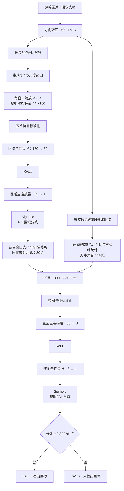

# 手工特征 + MLP 场景实测

## 1. 运行

在项目根目录执行：

```bash
# 摄像头0：实时识别
uv run robot-cleaning-vision run

# 指定图片：预测并保存结果
uv run robot-cleaning-vision run --input data/raw/taco/batch_5/000103.JPG

# 换摄像头
uv run robot-cleaning-vision run --camera 1
```

默认加载 `artifacts/mlp/model.pt`，使用模型内的阈值，不需要手动选择模型或输入预测文件。

- 摄像头窗口：`Q` / `Esc` / 关闭窗口退出；`S` / 空格保存当前帧。
- 图片模式：保存预测JSON与中文结果PNG。
- 摄像头保存：原图、预测JSON和中文结果PNG，三者对应同一帧。
- 默认保存到 `artifacts/inference/`；`--output` 可指定其他根目录。每次保存单独建目录，不覆盖其他结果。
- 中文字体默认使用Windows微软雅黑；可用 `--font 字体路径` 指定其他中文字体。

Windows下，整数摄像头索引使用DirectShow后端，视频文件和网络流仍自动选择后端。若提示无法打开设备，可检查摄像头占用情况，或用 `--camera 1` 指定其他设备。

## 2. 结果怎么看

**FAIL表示检出项目目标，PASS表示未检出。** 项目目标包括罐、瓶、柔性包装物、杯、纸类物品。

窗口右侧显示判定、FAIL分数和当前帧耗时。分数达到 **0.32226136326789856** 时判FAIL。此模型只做整图二分类，不绘目标框、不输出类别或计数。

场景实测时，分别观察有目标场景是否漏检、无目标场景是否误报；保存出错帧便于检查。

## 3. 模型的每一层

当前模型包含**两个小型MLP**：区域网络给每个窗口打分，整图网络综合所有窗口作最终判断。MLP是多层感知器，也就是带非线性激活的全连接神经网络。



N是自动生成的窗口数量。图中阈值为显示近似值，实际判定使用模型保存的完整数值。

### 3.1 输入：图片怎样变成160个数

图片先按拍摄方向转正，再保持长宽比缩放至长边640。程序生成不同大小、长宽比的窗口，每个窗口缩放到64×64。

每个窗口统计整块、左上、右上、左下、右下五个区域的**HSV颜色直方图**：

| 通道 | 含义 | 每区域分箱数 |
|---|---|---:|
| H：色相 | 什么颜色，例如红、绿、蓝 | 16 |
| S：饱和度 | 颜色有多鲜艳，越低越接近灰色 | 8 |
| V：明度 | 颜色有多亮，越低越接近黑色 | 8 |

直方图就是分区间统计像素比例。例如某个箱的值为0.25，表示该区域有25%的像素落在这个区间。

每区域32个数，五区域得到 `5×32=160` 维输入。随后逐列标准化：`(数值−训练集均值)/训练集缩放系数`。预测时直接使用模型保存的参数。

### 3.2 区域网络：160 → 32 → 1

| 环节 | 输入 → 输出 | 作用 | 可训练参数 |
|---|---|---|---:|
| 第一层 `Linear(160, 32)` | 160 → 32 | 将颜色特征组合成32个学习到的响应 | 5,152 |
| 激活层 `ReLU` | 32 → 32 | 负数变成0，正数不变，使网络能表达非线性关系 | 0 |
| 第二层 `Linear(32, 1)` | 32 → 1 | 综合32个响应，得到一个区域原始分数 | 33 |
| 输出变换 `Sigmoid` | 1 → 1 | 将原始分数映射到0～1，作为该区域的目标分数 | 0 |

`Linear`的计算是“输入与权重加权求和，再加偏置”。例如第一层有 `160×32` 个权重和32个偏置，共5,152个参数。32个隐藏单元不是32种物体，而是训练得到的特征组合。

最后一层的原始输出叫 **logit**，可以是任意实数；Sigmoid按 `1/(1+exp(−logit))` 转为分数。代码中Sigmoid在 `predict()` 调用，不写在 `_network()` 的层列表中。

一张图有N个窗口时，数据形状依次为 `(N,160) → (N,32) → (N,1)`。网络权重在所有窗口间共享。

### 3.3 中间汇总：N个区域分数 → 88个数

这一部分是固定的特征计算。

**先把区域分数汇总成30维：**

| 统计内容 | 维数 | 表达什么 |
|---|---:|---|
| 最高1、3、5、10、20个分数的平均值 | 5 | 最明显的局部目标证据 |
| 25%、50%、75%、90%、95%、99%分位数 | 6 | 全部区域分数的分布 |
| 均值、标准差 | 2 | 整体得分与差异程度 |
| 分数达到0.5、0.7、0.9、0.95、0.99的比例 | 5 | 高分区域有多少 |
| 小、中、大窗口各自的最大分数和最高三个分数均值 | 6 | 目标证据出现在哪种尺度 |
| 面积加权分数、最高分窗口面积、高分小窗口占比、邻域支持 | 4 | 证据大小及相邻窗口的一致性 |
| 整图窗口分数、候选数量的对数 | 2 | 全图参考与窗口数量 |

小、中、大窗口按面积占整图的比例划分：小于2%、2%至不足10%、至少10%。邻域支持检查相互重叠的窗口是否共同给出高分。

**再补充58维整图特征：**

从转正后的原图独立缩放到长边384，分成4×4块。每块计算HSV均值与标准差、灰度对比度、梯度强度、亮度突变、鲜艳像素比例、明亮低饱和度比例，共11项。

对16块的每项取均值、标准差、10%分位数、90%分位数和最大值，得到55维；再加入3个局部块相对整图的Lab颜色差异统计，得到58维。Lab是把明度与颜色分量分开表示的颜色空间。

将30维区域统计与58维整图特征拼接，得到**88维**。再使用整图网络自己的训练均值和缩放系数标准化，供下一网络输入。

### 3.4 整图网络：88 → 8 → 1

| 环节 | 输入 → 输出 | 作用 | 可训练参数 |
|---|---|---|---:|
| 第一层 `Linear(88, 8)` | 88 → 8 | 联合区域证据与整图背景，学习8个综合响应 | 712 |
| 激活层 `ReLU` | 8 → 8 | 引入非线性关系 | 0 |
| 第二层 `Linear(8, 1)` | 8 → 1 | 把8个响应合成一个整图logit | 9 |
| 输出变换 `Sigmoid` | 1 → 1 | 得到0～1的整图FAIL分数 | 0 |

整图网络可以学习“哪些区域证据结合什么背景更值得相信”，而不是只取所有窗口的最高分。

区域网络共有5,185个参数，整图网络共有721个，合计**5,906个可训练参数**。特征统计、标准化和Sigmoid没有额外的可训练网络权重。

### 3.5 最终判定与代码位置

公共后处理比较整图分数与模型阈值：

- 分数 ≥ `0.32226136326789856`：FAIL。
- 分数低于阈值：PASS。

`features.py`负责输入特征；`model.py::_network()`定义两种网络共用的层结构，`score_summary()`完成30维汇总，`MLPModel.predict()`按上述顺序串起计算；`inference.py`负责采集、后处理、中文显示与保存。

所有权重、两级标准化参数、窗口配置和阈值都保存在同一个 `model.pt` 中。

## 4. 重新训练

在项目根目录直接运行：

```bash
uv run python -m robot_cleaning_vision.models.mlp.train
```

`train.py`顶部集中配置数据路径、候选窗口、区域训练轮数、整图早停、种子和目标召回率。`training.py`实现下面的完整流程。

### 4.1 区域网络怎样训练

从正式train读取621张图片。每图最多取4个目标框作为正区域，再随机取8个与全部外扩目标框零交集的背景窗口作为负区域；每个区域提取与预测相同的160维HSV特征。

先限制每张原图的样本总权重，再让正、负类对训练的总贡献相同。每批完成清空梯度、前向计算、加权二元交叉熵、反向传播及Adam更新。区域网络固定训练17轮，学习率0.001、weight_decay为0.001、batch size为128。

### 4.2 为什么还要做三折训练

整图网络需要区域网络的分数，但不能只学习区域网络在熟悉图片上的表现。因此在train内部按`group_id`分成三折：每次用两折场景训练区域网络，给剩下一折图片打分。

每张训练图恰好留出一次，得到30维区域分数统计，再拼接58维整图特征，形成`(621, 88)`的整图训练矩阵。各折的标准化和类别权重仅由该折训练区域计算。

三折只负责生成训练输入。随后用全部train区域重新训练一个区域网络，作为最终保存和部署的区域网络。

### 4.3 整图网络、早停和阈值

整图网络使用折外88维输入训练；正式val的134张图通过最终区域网络生成输入，用来计算验证损失。其标准化参数只在621个整图训练向量上拟合。

整图网络学习率0.001、weight_decay为0.01、batch size为32，最多200轮；验证损失连续25轮未改善就早停，恢复验证损失最低的权重。最后仅在val上选择满足至少90%目标检出率、且尽量提高无目标放行率的阈值。

每次网络训练正常完成时均匀打印十次日志，不足十轮则每轮打印；早停会打印实际轮次。报告保存每一轮的数据。

### 4.4 新模型保存在哪里

每次训练新建`artifacts/mlp/training/<时间戳>/`：

| 文件 | 内容 |
|---|---|
| `model.pt` | 两个网络、两级标准化参数、窗口配置与阈值，可直接由`MLPModel.load(路径)`加载 |
| `training.json` | 实际配置、区域及整图逐轮损失、场景折、最佳轮次、验证指标及逐图分数 |
| `metrics.json` | 新模型的验证效果与文件哈希 |

训练不会覆盖当前`artifacts/mlp/model.pt`。确认新模型效果后，再决定是否将新目录的`model.pt`与`metrics.json`一起替换到该位置，供现有实测入口使用。

这里保留的是同一结构的训练方案，内部三折采用场景隔离；当前保留权重当时按原图分折。因此重新训练的指标可能不同，原模型效果表只对应当前保留权重。

## 5. 保留模型的效果

以下为已有134张验证图片的结果，不是本地场景验收结果：

| 指标 | 结果 |
|---|---:|
| 有目标检出率 | 92.52% |
| 无目标放行率 | 55.56% |
| 平衡准确率 | 74.04% |
| ROC-AUC | 0.860 |
| 漏检 / 误报 | 8 / 12 |

验证集参与过方案选择，汇总层训练的三折按原图而非场景划分。完整数值保存在 `artifacts/mlp/metrics.json`；场景实测仍需关注误报和漏检。

### ROC-AUC是什么

**ROC-AUC衡量模型区分有目标与无目标图片的能力，不只看某一个判定阈值。**

改变FAIL阈值会产生不同取舍：阈值降低，通常检出更多目标、误报也更多；阈值提高，通常误报减少、漏检增加。

ROC曲线把这些取舍画出来：横轴是**误报率**（无目标图片被判成FAIL的比例），纵轴是**检出率**（有目标图片被判成FAIL的比例）。AUC就是曲线下面积，取值为0～1。

| AUC | 含义 |
|---|---|
| 1 | 所有有目标图片的分数都高于无目标图片 |
| 0.5 | 排序能力接近随机 |
| 小于0.5 | 排序方向倾向于反了 |

当前验证集AUC约为0.860：随机抽一张有目标图片和一张无目标图片，模型约有86%的概率给有目标图片更高的FAIL分数，并列计半次。

**AUC不是预测正确率。** 实际漏检、误报还取决于判定阈值，因此要同时看检出率、放行率和混淆矩阵。

## 6. 保留的文件

- `artifacts/mlp/model.pt`：唯一模型权重。
- `artifacts/mlp/metrics.json`：该模型的效果摘要。
- `models/mlp/features.py`：窗口、颜色及整图特征。
- `models/mlp/model.py`：模型加载和预测。
- `models/mlp/train.py`：配置与无参数训练入口。
- `models/mlp/training.py`：区域训练、场景折外分数、整图训练及模型保存，负责具体如何训练。
- `inference.py`：采集、真实推理、公共后处理、显示和保存；默认配置位于顶部。

后面五项源码路径均位于 `src/robot_cleaning_vision/`。保留同一方案的训练和推理实现，不包含其他实验优化分支。
