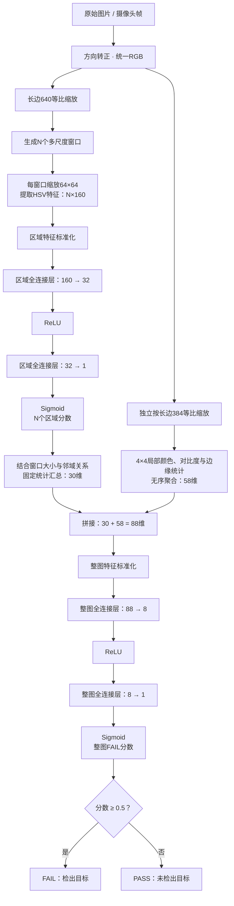

# 手工特征 + MLP

## 1. 运行

在项目根目录执行：

```bash
# 摄像头0：实时识别
uv run --locked robot-cleaning-vision run --model baseline1

# 指定图片：预测并保存结果
uv run --locked robot-cleaning-vision run --model baseline1 --input data/raw/taco/batch_5/000103.JPG

# 换摄像头
uv run --locked robot-cleaning-vision run --model baseline1 --camera 1
```

默认加载 `artifacts/mlp/model.pt`；命令行实测使用 `0.5` 阈值，无需指定权重或预测文件。

- 摄像头窗口：`Q` / `Esc` / 关闭窗口退出；`S` / 空格保存当前帧。
- 图片模式保存 `original.png`、`prediction.json` 和中文结果 `result.png`。
- 摄像头保存：原图、预测JSON和中文结果PNG，三者对应同一帧。
- 默认保存到 `artifacts/inference/`；`--output` 可指定其他根目录。每次保存单独建目录，不覆盖其他结果。
- 中文字体默认使用Windows微软雅黑；可用 `--font 字体路径` 指定其他中文字体。

Windows下，整数摄像头索引使用DirectShow后端，视频文件和网络流仍自动选择后端。若提示无法打开设备，可检查摄像头占用情况，或用 `--camera 1` 指定其他设备。

## 2. 结果怎么看

**FAIL表示检出项目目标，PASS表示未检出。** 项目目标包括罐、瓶、柔性包装物、杯、纸类物品。

窗口右侧显示判定、FAIL 分数和当前帧耗时。命令行在分数达到 **0.5** 时判 FAIL。`prediction.json` 的 `fail_probability` 字段记录这个 Sigmoid 分数。模型只做整图二分类，不绘制目标框，也不输出类别或计数。

场景实测时，分别观察有目标场景是否漏检、无目标场景是否误报；保存出错帧便于检查。

## 3. 模型的每一层

当前模型包含**两个小型MLP**：区域网络给每个窗口打分，整图网络综合所有窗口作最终判断。MLP是多层感知器，也就是带非线性激活的全连接神经网络。



N 是自动生成的窗口数量。验证、测试和命令行均使用 `0.5` 阈值。

### 3.1 输入：图片怎样变成160个数

图片先按拍摄方向转正，再保持长宽比缩放至长边640。程序生成不同大小、长宽比的窗口，每个窗口缩放到64×64。

每个窗口统计整块、左上、右上、左下、右下五个区域的**HSV颜色直方图**：

| 通道 | 含义 | 每区域分箱数 |
|---|---|---:|
| H：色相 | 什么颜色，例如红、绿、蓝 | 16 |
| S：饱和度 | 颜色有多鲜艳，越低越接近灰色 | 8 |
| V：明度 | 颜色有多亮，越低越接近黑色 | 8 |

直方图就是分区间统计像素比例。例如某个箱的值为0.25，表示该区域有25%的像素落在这个区间。

每区域32个数，五区域得到 `5×32=160` 维输入。随后逐列标准化：`(数值−训练集均值)/训练集缩放系数`。预测时直接使用模型保存的参数。

### 3.2 区域网络：160 → 32 → 1

| 环节 | 输入 → 输出 | 作用 | 可训练参数 |
|---|---|---|---:|
| 第一层 `Linear(160, 32)` | 160 → 32 | 将颜色特征组合成32个学习到的响应 | 5,152 |
| 激活层 `ReLU` | 32 → 32 | 负数变成0，正数不变，使网络能表达非线性关系 | 0 |
| 第二层 `Linear(32, 1)` | 32 → 1 | 综合32个响应，得到一个区域原始分数 | 33 |
| 输出变换 `Sigmoid` | 1 → 1 | 将原始分数映射到0～1，作为该区域的目标分数 | 0 |

`Linear` 计算输入与权重的加权和，再加偏置。第一层共有 `160×32` 个权重和 32 个偏置；32 个隐藏单元各学习一个特征组合。

最后一层的原始输出叫 **logit**，可以是任意实数。`predict()` 用 Sigmoid 将它转为 [0, 1] 内的分数。

一张图有N个窗口时，数据形状依次为 `(N,160) → (N,32) → (N,1)`。网络权重在所有窗口间共享。

### 3.3 中间汇总：N个区域分数 → 88个数

这一部分是固定的特征计算。

**先把区域分数汇总成30维：**

| 统计内容 | 维数 | 表达什么 |
|---|---:|---|
| 最高1、3、5、10、20个分数的平均值 | 5 | 最明显的局部目标证据 |
| 25%、50%、75%、90%、95%、99%分位数 | 6 | 全部区域分数的分布 |
| 均值、标准差 | 2 | 整体得分与差异程度 |
| 分数达到0.5、0.7、0.9、0.95、0.99的比例 | 5 | 高分区域有多少 |
| 小、中、大窗口各自的最大分数和最高三个分数均值 | 6 | 目标证据出现在哪种尺度 |
| 面积加权分数、最高分窗口面积、高分小窗口占比、邻域支持 | 4 | 证据大小及相邻窗口的一致性 |
| 整图窗口分数、候选数量的对数 | 2 | 全图参考与窗口数量 |

小、中、大窗口按面积占整图的比例划分：小于2%、2%至不足10%、至少10%。邻域支持检查相互重叠的窗口是否共同给出高分。

**再补充58维整图特征：**

从转正后的原图独立缩放到长边384，分成4×4块。每块计算HSV均值与标准差、灰度对比度、梯度强度、亮度突变、鲜艳像素比例、明亮低饱和度比例，共11项。

对16块的每项取均值、标准差、10%分位数、90%分位数和最大值，得到55维；再加入3个局部块相对整图的Lab颜色差异统计，得到58维。Lab是把明度与颜色分量分开表示的颜色空间。

将30维区域统计与58维整图特征拼接，得到**88维**。再使用整图网络自己的训练均值和缩放系数标准化，供下一网络输入。

### 3.4 整图网络：88 → 8 → 1

| 环节 | 输入 → 输出 | 作用 | 可训练参数 |
|---|---|---|---:|
| 第一层 `Linear(88, 8)` | 88 → 8 | 联合区域证据与整图背景，学习8个综合响应 | 712 |
| 激活层 `ReLU` | 8 → 8 | 引入非线性关系 | 0 |
| 第二层 `Linear(8, 1)` | 8 → 1 | 把8个响应合成一个整图logit | 9 |
| 输出变换 `Sigmoid` | 1 → 1 | 得到0～1的整图FAIL分数 | 0 |

整图网络结合区域分数的分布和整图背景特征作出判断。

区域网络共有5,185个参数，整图网络共有721个，合计**5,906个可训练参数**。特征统计、标准化和Sigmoid没有额外的可训练网络权重。

### 3.5 最终判定与代码位置

公共后处理比较整图分数与调用方指定的阈值：达到阈值判 FAIL，低于阈值判 PASS。
`baseline1` CLI 使用与训练评估共用的固定阈值 `0.5`，包括用 `--model-path` 试用其他 MLP 权重时。

`features.py`负责输入特征；`model.py::_network()`定义两种网络共用的层结构，`score_summary()`完成30维汇总，`MLPModel.predict()`按上述顺序串起计算；`inference.py`负责采集、后处理、中文显示与保存。

所有权重、两级标准化参数、窗口配置和阈值都保存在同一个 `model.pt` 中。

## 4. 重新训练

先按[数据准备指南](../dataprocessing/README.md)准备原图和标注。保留模型使用以下训练分区：

| 来源 | PASS | FAIL | 图片根目录 | 项目标注 |
|---|---:|---:|---|---|
| TACO train | 124 | 497 | `data/raw/taco/` | `data/raw/taco/annotations_project.json` |
| CoxPWD | 70 | 40 | `data/raw/supplemental/` | `data/processed/supplemental/annotations_project.json` |
| Wikimedia | 21 | 0 | `data/raw/supplemental/` | 同上 |
| 本地审核图 | 3 | 192 | `data/raw/supplemental/local_training/` | `data/processed/supplemental/local_training_annotations_project.json` |

在项目根目录执行：

```bash
uv sync --locked
uv run --locked python -m robot_cleaning_vision.models.mlp.train --supplemental all --local-training-root data/raw/supplemental/local_training --image-fail-weight 1.5 --image-weight-decay 0.01
```

`--local-training-root` 是标注中 `file_name` 的相对路径起点。JPG 和逐图 JSON 保存在 `data/raw/supplemental/local_training/训练集/` 的分类目录下，包含未纳入训练的原件；实测图片仍单独存放在 `data/raw/local/`。训练仅使用审核标注列出的 195 张本地图片。

### 4.1 区域训练及场景折外特征

区域 MLP 每图最多取 4 个目标框和 8 个避开全部外扩目标框的背景窗口。区域训练固定 17 轮，Adam 学习率为 `0.001`、`weight_decay` 为 `0.001`、批大小为 128，采样与训练种子均为 `42`。

947 张训练图按 `group_id` 用 `StratifiedGroupKFold` 分成三折（分折种子 `123`）。每次只用两折拟合区域模型、特征标准化参数和类别权重，再为留出折生成整图特征。这使同一场景的图片和目标区域不会进入为它打分的模型。整图网络使用 947 行折外特征；部署的区域模型另用全部训练图拟合，并为原 TACO val 生成输入。

### 4.2 整图训练和判定

整图训练的 FAIL 类总损失权重为 PASS 类的 `1.5` 倍。Adam 学习率为 `0.001`、`weight_decay` 为 `0.01`、批大小为 32、最多 200 轮。按原 TACO val 上的类别均衡损失早停，连续 25 轮无改善时恢复最低损失权重；保留配置的最佳整图轮次为 31。

选型在原 TACO val 上以固定 `0.5` 计算指标。先看 FAIL 召回能否达到 90%，再依次取平衡准确率更高、FAIL 召回更高、参数量更小的模型；全部低于 90% 时从平衡准确率开始比较。原 TACO test 只用于模型冻结后的评估，阈值仍为 `0.5`。

### 4.3 试用和核对产物

训练在 `artifacts/mlp/training/` 下新建时间戳目录，不覆盖默认模型。该目录的 `model.pt` 可用 `run --model baseline1 --model-path <权重路径> --input <图片路径>` 试用；`training.json` 记录配置、折分与最佳轮次，`metrics.json` 记录该次验证指标和权重 SHA-256。

默认入口使用 `artifacts/mlp/model.pt`。同目录的 `metrics.json` 保存保留配置、标注路径及摘要、场景折、最佳轮次、原 TACO 验证／测试指标及权重 SHA-256。要安装复现的权重，先核对其 SHA-256，再将新目录的 `model.pt` 复制到默认路径。核对默认权重可运行：

```bash
uv run --locked python -c "import hashlib; from pathlib import Path; print(hashlib.sha256(Path('artifacts/mlp/model.pt').read_bytes()).hexdigest())"
```
