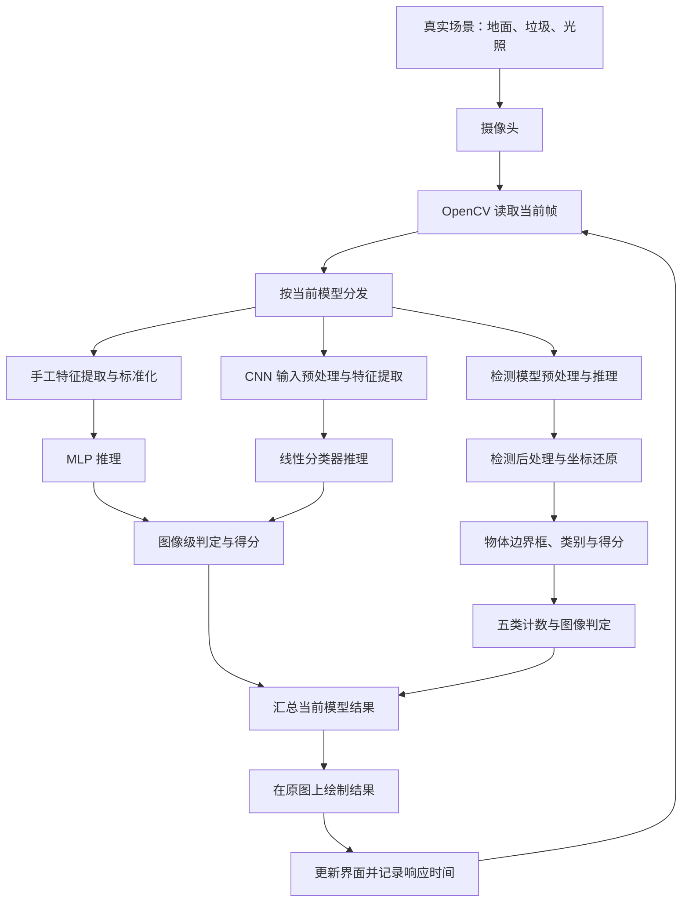

# 架构设计

## 1. 实时调用链路

摄像头提供新画面，程序根据当前选择的方法完成预测，再将结果显示在原图上。三种基线共用采集、结果汇总和显示模块，各自使用对应的预处理与模型。

检测分支同时用于物体级基线与最终改进系统。连续模式显示后读取下一帧；按需模式在用户触发采集时处理一帧。

## 2. 模块职责

| 模块 | 职责 |
|---|---|
| 摄像头采集 | 通过 OpenCV 获取新画面，保留原始图像，供推理与结果显示使用。 |
| 模型选择与加载 | 按模型 ID 加载权重、预处理配置、类别映射和阈值；每帧复用当前模型。 |
| 预处理与特征提取 | 按所选方法调整尺寸、颜色空间和数值范围；计算手工特征或 CNN 特征。 |
| 模型推理 | 执行 MLP、线性分类器或目标检测器，产生对应的预测输出。 |
| 结果处理 | 将分类得分转为图像判定；或处理检测候选，生成物体结果、五类数量与图像判定。 |
| 结果显示 | 绘制当前模型支持的内容，显示模型名称和最近一次完成帧的响应时间，并处理模型切换与退出操作。 |

模型加载在选择模型时完成，不放入逐帧处理过程。切换模型时一并切换其预处理、阈值与类别配置。

## 3. 三种方法的处理差异

### 手工特征 + MLP

从当前帧计算颜色直方图、HOG 等特征，使用训练时保存的统计量进行标准化，再输入 MLP。模型输出图像级得分，按验证集确定的阈值生成 `PASS/FAIL`。

### 冻结 CNN + 线性分类器

按预训练 CNN 的要求处理图像，使用冻结的 CNN 提取特征，再交给线性分类器。分类器输出图像级得分和 `PASS/FAIL`。CNN 采用推理模式。

### 目标检测器

将当前帧转换为检测模型所需输入，推理得到候选框、类别和得分。后处理执行得分筛选，以及所选检测器需要的重复框抑制，再将框坐标还原到原图。

根据最终保留的目标生成结果：

- 逐物体输出原图坐标下的边界框、五类之一的类别及得分。
- 按类别统计数量，包括数量为零的类别。
- 至少保留一个目标时为 `FAIL`，否则为 `PASS`。

缩放比例、填充偏移等变换信息随预处理保留，用于坐标还原；结果绘制使用原图。

## 4. 模型 ID 与结果约定

| 模型 ID | 对应方法 | 界面结果 |
|---|---|---|
| `baseline1` | 手工特征 + MLP | 图像判定、分类得分、响应时间 |
| `baseline2` | 冻结 CNN 特征 + 线性分类器 | 图像判定、分类得分、响应时间 |
| `baseline3` | 五类目标检测基线 | 框、类别、物体得分、五类计数、图像判定、响应时间 |
| `final` | 最终改进的物体级系统 | 与检测基线相同的结果类型 |

各方法将预测结果交给同一个显示模块，包含当前模型 ID、处理状态、图像判定、得分及其含义，以及适用的物体结果和计数。每帧完成显示更新后，再记录该帧响应时间。

图像分类方法的物体结果与计数记为“不适用”；检测方法成功处理空场景时，物体列表为空，五类计数为零。基于检测规则的图像判定没有独立图像置信度时，图像得分记为 `null`，保留各物体得分。

采集或推理失败时显示错误状态。成功完成处理后再生成图像判定。

## 5. 响应时间

从新帧可供程序处理时开始计时，到处理完成并完成显示更新调用为止，包含预处理、特征提取、推理与后处理。使用 GPU 时同步计算后计时。

模型文件加载不计入逐帧延迟。比较模型时，各使用至少 20 个新采集帧，报告延迟中位数与第 95 百分位数。

本帧显示更新完成后记录耗时，界面在下一次更新时显示该值。

## 6. TACO 与模型训练的位置

TACO 用于离线的数据整理、训练与评估。将原始标注映射为项目五类，为分类方法生成图像标签，为检测方法准备逐物体类别与边界框。按 70%／15%／15% 的目标比例固定划分训练集、交叉验证集和测试集，三种方法共用划分；本地摄像头数据单独用于实际场景评估。

训练完成后保存模型权重、特征标准化参数、预处理配置、类别映射与判定阈值。实时程序加载这些产物，处理摄像头画面。

批量预测与实时预测复用相同的预处理、推理和结果处理逻辑；区别是输入来自图片目录，输出写入 CSV 与运行配置文件。

相关文档：[三种视觉方法](三种视觉方法.md) · [TACO 数据集](TACO数据集.md) · [项目需求](项目分析.md)