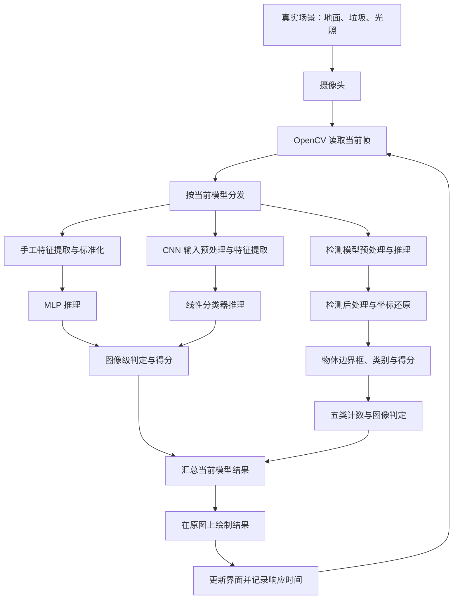

# 架构设计

## 1. 实时调用链路

摄像头提供新画面，程序根据当前选择的方法完成预测，再将结果显示在原图上。三种基线共用采集、结果汇总和显示模块，各自使用对应的预处理与模型。



检测分支同时用于物体级基线与最终改进系统。连续模式显示后读取下一帧；按需模式在用户触发采集时处理一帧。

## 2. 模块职责

| 模块 | 职责 |
|---|---|
| 摄像头采集 | 通过独立 OpenCV 接口获取原始 BGR 新帧，供推理复用；采集子命令另负责实时预览、场景图片保存与 CSV 元数据追加。 |
| 模型选择与加载 | 按模型 ID 加载权重、预处理配置、类别映射和阈值；每帧复用当前模型。 |
| 预处理与特征提取 | 按所选方法调整尺寸、颜色空间和数值范围；计算手工特征或 CNN 特征。 |
| 模型推理 | 执行 MLP、线性分类器或目标检测器，产生对应的预测输出。 |
| 结果处理 | 将分类得分转为图像判定；或处理检测候选，生成物体结果、五类数量与图像判定。 |
| 结果显示 | 绘制当前模型支持的内容，显示模型名称和最近一次完成帧的响应时间，并处理模型切换与退出操作。 |

模型加载在选择模型时完成，不放入逐帧处理过程。切换模型时一并切换其预处理、阈值与类别配置。

### 2.1 本地采集模块

统一入口为 `main.py` 的 `capture` 子命令，保留顶层及子命令 `--help`：

```bash
uv run robot-cleaning-vision capture --camera 0 --output data/raw/local --scene-id scene_001
```

实现位于 `src/robot_cleaning_vision/capture/`，职责分离如下：

| 文件 | 接口与职责 |
|---|---|
| `camera.py` | `Camera(source, width=None, height=None)`；`open()` 打开设备，`read()` 读取一帧，`release()` 释放，支持上下文管理；不处理窗口或按键。 |
| `storage.py` | `ImageStore(output, scene_id, camera_source).save(frame, captured_at=None)`；保存无损 PNG，成功后追加 `images.csv`，返回 `ImageRecord`；不生成类别、框或判定。 |
| `preview.py` | `run_capture()` 单线程调度读取、显示和按键；`draw_preview()` 仅在副本绘制场景、本次成功保存数量、操作提示和保存状态。 |

`source` 为整数时表示设备索引，为字符串时表示 OpenCV 可读取的视频流地址或视频文件路径。相对文件路径和输出目录均以进程工作目录为基准。分辨率参数按宽、高分别指定，单位像素，仅向设备提出请求；实际尺寸以读取帧为准。原始帧约定为 BGR `numpy.ndarray`，形状 `(height, width, 3)`，`dtype=uint8`，不隐式缩放或转换通道。

每轮先读取原图并记录带时区的本地读取完成时间，再在副本绘制提示并显示，随后读取按键；`S/s` 或空格在下一次读帧前保存本轮原图，保证保存内容与当前显示源对应，且不含叠字。`Q/q`、Esc、关闭窗口正常退出。窗口标题保留完整场景名，画面内非 ASCII 字符转义显示，以适配 OpenCV 内置字体。

场景目录为 `<output>/<scene_id>/`；同一物理布置共用 `scene_id`，改变物体布置后必须指定新场景。图片名采用时间戳加 UUID，并独占创建，防止跨次采集覆盖。`<output>/images.csv` 使用 UTF-8，只在空文件写表头，每张成功图片追加一行：

- `image_id`：唯一 PNG 文件名。
- `scene_id`：物理场景名。
- `file_name`：相对输出根目录的 POSIX 图片路径。
- `captured_at`：读取完成时间的 ISO 8601 字符串，含时区偏移。
- `width`、`height`：实际保存宽、高（像素）。
- `camera_source`：采集来源的字符串表示。

图片写入完成后才追加 CSV，已有记录保留。CSV 表头不兼容时拒绝追加；可处理的追加失败回退本次写入并删除未登记图片，不改动旧图片。该接口面向单线程、单写入进程，不保证强杀、断电和多个进程共写时的事务性。

保存成功在终端报告完整路径并增加本次计数；保存失败报告原因，保持计数并允许继续。打开失败、读帧失败（含视频流结束）明确报错；读帧失败立即释放设备。预览循环通过 `finally` 在正常、按键、窗口关闭、键盘中断及异常路径释放摄像头并关闭窗口，模型循环也可用 `with Camera(...)` 管理生命周期。

采集输出只有图片与元数据，后续标注流程再补充类别、边界框和 `PASS/FAIL`。命令参数与按键详见 [README](../README.md#摄像头采集)。


### 2.2 离线预测结果处理入口

`main.py` 的 `process` 子命令读取原图与外部模型预测 JSON，调用
`preprocess` 取得 letterbox 变换，再分发至分类或检测后处理，最后使用
`ResultRenderer.draw` 绘制并保存新的标注 PNG。命令示例见
[用已有预测生成标注图](../README.md#用已有预测生成标注图)。

`process` 不执行推理；直接识别图片或摄像头画面见 [run 命令](../README.md#图片和摄像头识别)，可选模型为 `baseline1`、`baseline2`、`baseline3`。
检测 JSON 的框对应指定预处理尺寸，不能是已还原的框；传入的耗时为外部最近完成帧耗时，
不由绘制模块计时。文件读取与保存属于入口，三个公共模块仍保持各自职责。

## 3. 三种方法的处理差异

### 手工特征 + MLP

`baseline1` 先用区域 MLP 给多尺度窗口的 HSV 直方图打分，再将区域分数统计与整图颜色、亮度和边缘统计拼接，交给整图 MLP。验证和命令行均在整图分数达到 `0.5` 时判 `FAIL`。数据、训练与部署命令见[手工特征 + MLP](手工特征+MLP.md)。

### 冻结 CNN + 线性分类器

`baseline2` 使用 torchvision ResNet-50 `IMAGENET1K_V2` 权重。共用预处理模块将完整画面等比缩放并居中填充到权重保存的输入尺寸，
再按 ImageNet RGB 统计量归一化。CNN 的参数和 BatchNorm 状态固定，移除原分类层，取全局平均池化后的 2048 维特征。
`StandardScaler` 和 L2 逻辑回归只在训练集拟合：TACO train、审核后的 CoxPWD/Wikimedia 训练图、Indoor Waste train 和本地审核实拍图，共 999 张。
TACO val 选阈值时先要求 FAIL 召回率 ≥90%，再依次选择 PASS 召回率更高、FAIL 召回率更高的阈值；
阈值取保持该判定的相邻得分间隔中点，全保留时取 0。整图 `P(FAIL) >= threshold` 时判 FAIL。

默认推理固定加载 `artifacts/cnn_linear/model.pt`；`--model-path` 可指定另一份权重。
训练命令为 `uv run --locked python -m robot_cleaning_vision.models.cnn_linear.train`，
每次只在 `artifacts/cnn_linear/training/<新目录>/model.pt` 保存新权重，终端报告 TACO val 的校准阈值和评估指标。
预处理、数据分区与权重格式详见[冻结 CNN + 线性分类器](冻结CNN+线性分类器.md)。

### 目标检测器

`baseline3` 每次运行从 `artifacts/detector/model.pt` 加载一次 Ultralytics YOLO11n Detect，可用 `--model-path` 指定其他同格式权重。加载时核对项目类别 1–5 依次对应 YOLO 类别 0–4：`can`、`bottle`、`wrapper`、`cup`、`paper`。

图片按 EXIF 转正，摄像头直接提供 BGR 帧。项目预处理将原图一次性缩放并填充到 640×640 画布；Ultralytics 完成解码与类别内 NMS（置信度 0.25、IoU 0.7）。框裁剪到画布的有效图像区域，公共后处理还原原图坐标并计数，不重复 NMS。保存的 `prediction.json` 保留了供 `process` 回放的画布框，同时单列原图框。操作见 [README](../README.md#用已有预测生成标注图)，模型与训练细节见 [YOLO 目标检测](YOLO目标检测.md)。

根据最终保留的目标生成结果：

- 逐物体输出原图坐标下的边界框、五类之一的类别及得分。
- 按类别统计数量，包括数量为零的类别。
- 至少保留一个目标时为 `FAIL`，否则为 `PASS`。

统一返回 `ImageResult`：`decision` 为图像判定，分类的 `image_score` 为 FAIL 概率且 `objects/counts` 为 `None`；检测的 `image_score` 为 `None`，`objects` 保留各目标的原图 xyxy 框、类别 ID 与得分，`counts` 包含全部五类。模块只提供 Python API，不绘图、不导出文件；输入输出与调用示例见[后处理模块](后处理模块.md)。

缩放比例、填充偏移等变换信息随预处理保留，用于坐标还原；结果绘制使用原图。

## 4. 模型 ID 与结果约定

| 模型 ID | 对应方法 | 界面结果 |
|---|---|---|
| `baseline1` | 手工特征 + MLP | 图像判定、分类得分、响应时间 |
| `baseline2` | 冻结 CNN 特征 + 线性分类器 | 图像判定、分类得分、响应时间 |
| `baseline3` | 五类目标检测基线 | 框、类别、物体得分、五类计数、图像判定、响应时间 |
| `final` | 最终改进的物体级系统 | 与检测基线相同的结果类型 |

各方法将预测结果交给同一个显示模块，包含当前模型 ID、处理状态、图像判定、得分及其含义，以及适用的物体结果和计数。每帧完成显示更新后，再记录该帧响应时间。

图像分类方法的物体结果与计数记为“不适用”；检测方法成功处理空场景时，物体列表为空，五类计数为零。基于检测规则的图像判定没有独立图像置信度时，图像得分记为 `null`，保留各物体得分。

采集或推理失败时显示错误状态。成功完成处理后再生成图像判定。

## 5. 响应时间

从新帧可供程序处理时开始计时，到处理完成并完成显示更新调用为止，包含预处理、特征提取、推理与后处理。使用 GPU 时同步计算后计时。

模型文件加载不计入逐帧延迟。比较模型时，各使用至少 20 个新采集帧，报告延迟中位数与第 95 百分位数。

本帧显示更新完成后记录耗时，界面在下一次更新时显示该值。

## 6. TACO 与模型训练的位置

TACO 用于离线的数据整理、训练与评估。将原始标注映射为项目五类，为分类方法生成图像标签，为检测方法准备逐物体类别与边界框。按 70%／15%／15% 的目标比例固定划分训练集、交叉验证集和测试集，三种方法共用划分；本地摄像头数据单独用于实际场景评估。

训练完成后保存模型权重、特征标准化参数、预处理配置、类别映射与判定阈值。实时程序加载这些产物，处理摄像头画面。

批量预测与实时预测复用相同的预处理、推理和结果处理逻辑；区别是输入来自图片目录，输出写入 CSV 与运行配置文件。

相关文档：[三种视觉方法](三种视觉方法.md) · [TACO 数据集](TACO数据集.md) · [项目需求](项目分析.md)